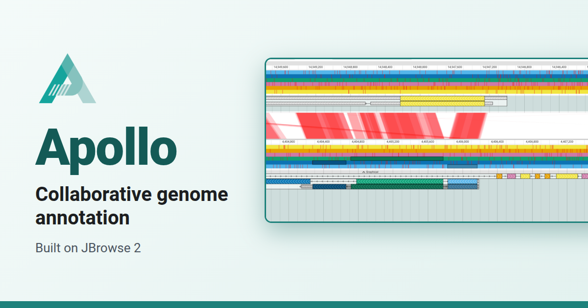

# Apollo

**Visit the website at [apollo.jbrowse.org](https://apollo.jbrowse.org)** for
documentation, a live demo, and [news](https://apollo.jbrowse.org/blog).

Apollo is a genome annotation editor built as a plugin for
[JBrowse 2](https://jbrowse.org/jb2/). Create and refine gene models directly on
any genome, next to any evidence JBrowse can display. Work on your own in a web
browser or on the desktop, or with a team in real time on a shared server.

## Features

- **Real-time collaboration**: Teams share one copy of each genome on an Apollo
  collaboration server. Every edit appears for everyone at once and is recorded
  in a changelog.
- **Works on your own, too**: Use Apollo by yourself in JBrowse 2 on the web or
  JBrowse Desktop, with no server to install.
- **Annotate with any evidence**: Show RNA-seq, gene models, synteny with
  related genomes, or any other track JBrowse supports. Copy features from
  evidence straight into your annotations.
- **Edit gene models with checks**: Add genes and transcripts, merge and split
  exons, and see the protein translation as you go. Apollo flags missing or
  internal stop codons and unexpected splice sites. You can also configure your
  own custom checks.
- **Standard formats and automation**: Import and export GFF3 and FASTA. Script
  any task with the command-line tool or the REST API.
- **Extensible**: Apollo is a JBrowse 2 plugin, and can itself be customized
  with plugins on the client and the server, for example to add new login
  methods.

## Get started

- **Learn Apollo**: The [user guide](https://apollo.jbrowse.org/docs/user-guide)
  walks you step by step through creating and editing your first gene models.
- **Annotate on your own**: Use Apollo in
  [JBrowse 2 on the web](https://apollo.jbrowse.org/docs/single-user/jbrowse-web)
  or with your own data in
  [JBrowse Desktop](https://apollo.jbrowse.org/docs/single-user/jbrowse-desktop).
- **Annotate as a team**: Set up an Apollo collaboration server. Try the
  [local demo](https://apollo.jbrowse.org/docs/multi-user/local-demo/setting-up)
  first, then follow the
  [installation guide](https://apollo.jbrowse.org/docs/multi-user/installation/background).
- **Automate**: Install the command-line tool with
  `npm install -g @apollo-annotation/cli` and see the
  [CLI guide](https://apollo.jbrowse.org/docs/multi-user/guides/cli), or use the
  [REST API](https://apollo.jbrowse.org/docs/multi-user/guides/rest-api).

Questions? Ask in
[GitHub Discussions](https://github.com/GMOD/Apollo3/discussions) or
[report a bug](https://github.com/GMOD/Apollo3/issues/new/choose).

## Cite Apollo

If you use Apollo in your research, please cite:

- Stevens, G. J., et al. (2026). Apollo 3: Multi-Species Genome Curation.
  _bioRxiv_. https://doi.org/10.64898/2026.06.08.730970
- Dunn, N. A., et al. (2019). Apollo: Democratizing genome annotation. _PLOS
  Computational Biology_, 15(2), e1006790.
  https://doi.org/10.1371/journal.pcbi.1006790
- Diesh, C., et al. (2023). JBrowse 2: a modular genome browser with views of
  synteny and structural variation. _Genome Biology_, 24(1), 74.
  https://doi.org/10.1186/s13059-023-02914-z

Full author lists and BibTeX are on the
[website](https://apollo.jbrowse.org/#cite), and GitHub's "Cite this repository"
button uses [CITATION.cff](./CITATION.cff).

## Funding

Apollo is funded by the National Institute of General Medical Sciences of the
U.S. National Institutes of Health
([R01GM080203](https://reporter.nih.gov/project-details/11394475)). Earlier
development was also supported by a joint award from the U.S. National Science
Foundation
([2031120](https://www.nsf.gov/awardsearch/show-award/?AWD_ID=2031120)) and the
UK Biotechnology and Biological Sciences Research Council
([BB/T016299/1](https://gtr.ukri.org/find-research-and-innovation/project/7ea4b6c9-fd2d-4660-889b-8f082b11dd2f)).

## For developers

This repository is a monorepo containing these packages. Published packages are
on npm under the `@apollo-annotation` scope.

| Package                                                                | npm                                                                                             | Description                                                                      |
| ---------------------------------------------------------------------- | ----------------------------------------------------------------------------------------------- | -------------------------------------------------------------------------------- |
| [jbrowse-plugin-apollo](./packages/jbrowse-plugin-apollo/)             | [jbrowse-plugin-apollo](https://www.npmjs.com/package/@apollo-annotation/jbrowse-plugin-apollo) | The Apollo client, as a JBrowse 2 plugin                                         |
| [apollo-collaboration-server](./packages/apollo-collaboration-server/) | Not published (Docker image)                                                                    | NestJS server for multi-user annotation: REST API, live updates, MongoDB storage |
| [apollo-cli](./packages/apollo-cli/)                                   | [cli](https://www.npmjs.com/package/@apollo-annotation/cli)                                     | Command-line tool for working with a collaboration server                        |
| [apollo-common](./packages/apollo-common/)                             | [common](https://www.npmjs.com/package/@apollo-annotation/common)                               | Public base classes for writing Apollo plugins                                   |
| [apollo-shared](./packages/apollo-shared/)                             | [shared](https://www.npmjs.com/package/@apollo-annotation/shared)                               | Internal code shared by the server, client, and CLI                              |
| [apollo-mst](./packages/apollo-mst/)                                   | [mst](https://www.npmjs.com/package/@apollo-annotation/mst)                                     | Internal mobx-state-tree models for the client                                   |
| [apollo-schemas](./packages/apollo-schemas/)                           | [schemas](https://www.npmjs.com/package/@apollo-annotation/schemas)                             | Internal MongoDB schemas for the server                                          |
| [website](./packages/website/)                                         | Not published                                                                                   | Source for https://apollo.jbrowse.org                                            |

See [the contribution guide](./CONTRIBUTING.md) for instructions to developers,
and the [developer guide](https://apollo.jbrowse.org/docs/developer-guide) for
writing Apollo plugins.

Apollo is licensed under the [Apache License 2.0](./LICENSE).
