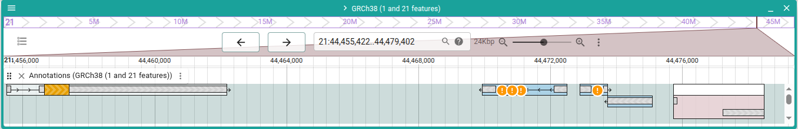
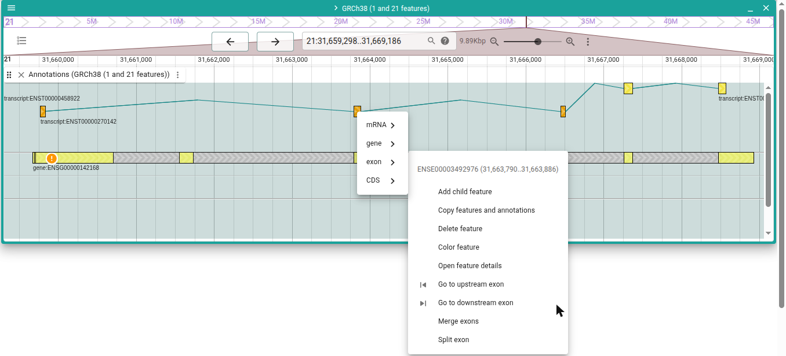
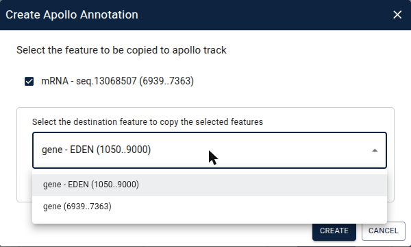
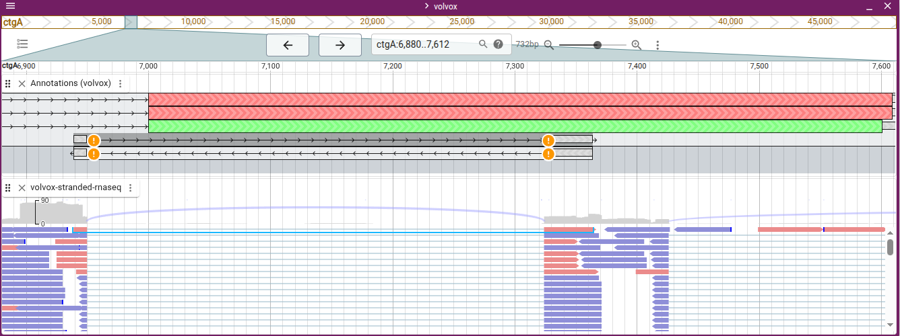
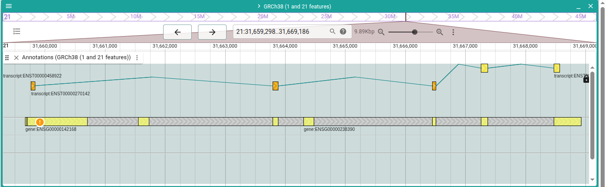

# Beta Version 0.3.9

We are excited to release version `v0.3.9` of Apollo 3. This release brings
several improvements to the six-frame view, easier CDS editing, reorganized
documentation, and a number of bug fixes. Below are some of the changes since
`v0.3.8` that we'd like to highlight.

<!-- truncate -->

## New features

### Customizable gene background colors

The background color of top-level features (e.g. genes) can now be customized by
feature type using the new `geneBackgroundColor` option in the `ApolloPlugin`
configuration. By default, features of type "pseudogene" and "ncRNA_gene" get a
colored background. See the "Themes and coloring" page in the documentation for
details.

### Navigate to neighboring exons in the six-frame view

The "Go to upstream/downstream exon" menu items introduced in the last release
are now also available in the six-frame view.

### Reorganized documentation

The documentation has been reorganized into "Try it out", "Installation", and
"Guides" sections, with several new guides on topics such as setting up a local
demo, managing assemblies, importing features, evidence tracks, and the
changelog.

## Improved functionality

### Simpler CDS editing in the transcript details

Editing CDS locations in the transcript details widget now works like the
translation panel does, checking that the new start and end fall on an
underlying exon and don't overlap.

### Copying evidence into genes on either strand

When creating an annotation from a JBrowse feature or alignments track, you can
now copy it into any gene in the region regardless of strand. The copied
transcript and its children are changed to match the strand of the destination
gene. The new feature is also now selected after it is created.

### Locked mode in the six-frame view

The six-frame view now shows the lock icon and respects locked mode, just like
the main annotation display.

### Lower memory use when importing GFF3

The GFF3 parser has been updated, and the collaboration server no longer runs
out of memory when importing large GFF3 files that don't contain `###`
directives. For files like this, related features that are very far apart in the
file may not import correctly, so sorting the GFF3 first is recommended.

## Bug fixes

- Users who are registered but have no role assigned can now load Apollo
  properly.
- Adding a feature now works for an assembly or reference sequence that has no
  features loaded yet, both when copying from an evidence track and when using
  "Add a feature" from the rubberband menu.
- The "Manage checks" dialog now works when the collaboration server is hosted
  in a subdirectory.
- The canonical splice site check now works correctly on the reverse strand.
- Intron strand arrows are flipped correctly when the view is reversed.
- The reference sequence track now displays correctly when multiple regions are
  shown.
- File compression is detected correctly in the "Add assembly" dialog.
- Row selection in the reference sequence alias configuration dialog works
  again.
- Feature labels in the six-frame view are now readable and no longer stick to
  the left side of the display, and lines connecting exons are drawn regardless
  of exon width.

## For more information

For more details on any of the changes mentioned as well as many more changes
that have been made, please reference the associated GitHub issues.

- Fix Refname alias data grid issues by @shashankbrgowda in
  https://github.com/GMOD/Apollo3/pull/687
- Simplify CDS editing in transcript details widget by @shashankbrgowda in
  https://github.com/GMOD/Apollo3/pull/686
- Change strand of transcript and its children to destination gene strand by
  @shashankbrgowda in https://github.com/GMOD/Apollo3/pull/689
- Add Lock Icon to LASFD by @haessar in https://github.com/GMOD/Apollo3/pull/696
- Add feature background customization docs by @dariober in
  https://github.com/GMOD/Apollo3/pull/690
- Fix for users with no role by @garrettjstevens in
  https://github.com/GMOD/Apollo3/pull/697
- Fix ManageChecks when collaboration server is in subdirectory by
  @garrettjstevens in https://github.com/GMOD/Apollo3/pull/703
- Update GFF parser to latest version by @garrettjstevens in
  https://github.com/GMOD/Apollo3/pull/681
- LASFD: Navigate to prev / next exon by @haessar in
  https://github.com/GMOD/Apollo3/pull/699
- dev: allow symlinks when serving jb2 by @alpapan in
  https://github.com/GMOD/Apollo3/pull/712
- Update eslint-plugin-react-hooks to v7 by @garrettjstevens in
  https://github.com/GMOD/Apollo3/pull/713
- bugfix: Clean up internet account event listeners by @garrettjstevens in
  https://github.com/GMOD/Apollo3/pull/714
- Bugfix: Detect file compression correctly in AddAssembly dialog by
  @garrettjstevens in https://github.com/GMOD/Apollo3/pull/715
- Reorganize docs, add several new guides by @garrettjstevens in
  https://github.com/GMOD/Apollo3/pull/685
- Fix: flip intron strand arrows when view is reversed by @garrettjstevens in
  https://github.com/GMOD/Apollo3/pull/717
- Fix: select feature when we create new feature from JBrowse track by
  @shashankbrgowda in https://github.com/GMOD/Apollo3/pull/718
- Fix collaboration server running out of memory on GFF3 import by
  @garrettjstevens in https://github.com/GMOD/Apollo3/pull/719
- Fix for adding features to assembly or refSeq that's not loaded yet by
  @garrettjstevens in https://github.com/GMOD/Apollo3/pull/723
- Fix sequence track when displaying multiple regions by @garrettjstevens in
  https://github.com/GMOD/Apollo3/pull/724
- LASFD Feature Label fixes by @haessar in
  https://github.com/GMOD/Apollo3/pull/729
- Render LASFD exon-connecting lines regardless of exon width by @haessar in
  https://github.com/GMOD/Apollo3/pull/730
- Fix splice site check on reverse strand by @garrettjstevens in
  https://github.com/GMOD/Apollo3/pull/733

### New Contributors

- @alpapan made their first contribution in
  https://github.com/GMOD/Apollo3/pull/712

**Full Changelog**: https://github.com/GMOD/Apollo3/compare/v0.3.8...v0.3.9
