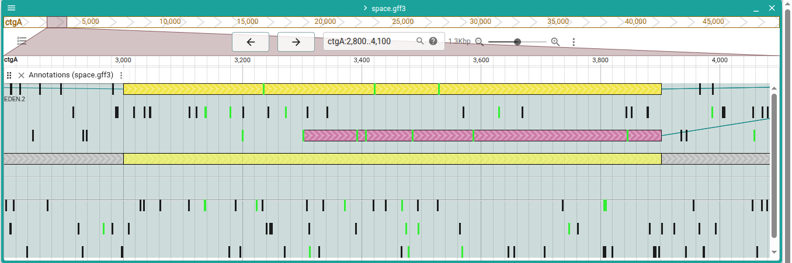
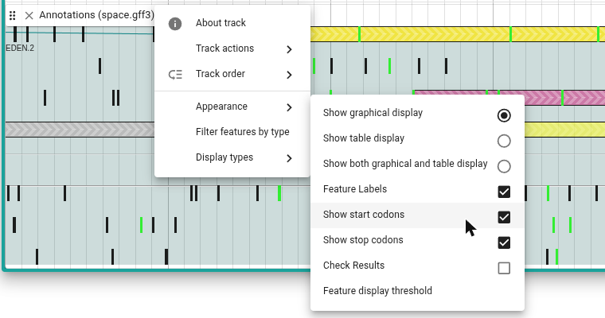
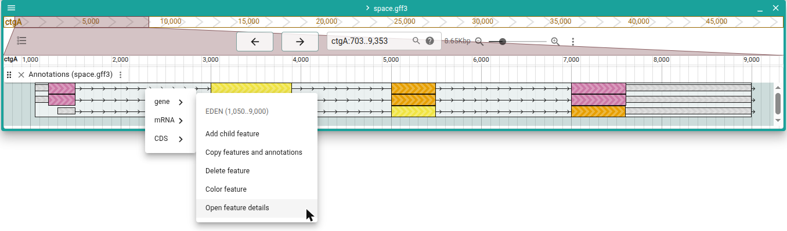
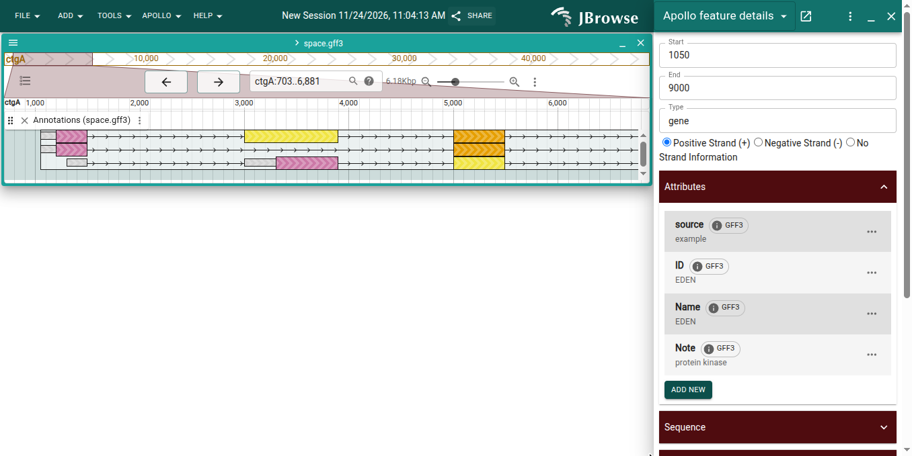

# Beta Version 0.3.10

We are excited to release version `v0.3.10` of Apollo 3. This release adds start
and stop codons to the six-frame view, new server options for administrators,
and several improvements to the sequence display. Below are some of the changes
since `v0.3.9` that we'd like to highlight.

<!-- truncate -->

## New features

### Start and stop codons in the six-frame view

The six-frame view can now draw start and stop codons. They can be toggled from
the track's "Appearance" menu, with stop codons shown and start codons hidden by
default. The colors (green for start, black for stop) match those used in
Artemis.

### "Open feature details" in the right-click menu

All feature right-click menus now have an "Open feature details" item. This is
especially useful for genes, where there may not be any part of the gene that
isn't covered by another feature you could click on.

### Configurable indexed IDs

A new collaboration server option, `INDEXED_IDS`, takes a comma-separated list
of feature attributes (e.g. `gff_id,gene_id,transcript_id`) to treat as
identifiers. Values of these attributes are indexed when features are imported
or created, and can be looked up with the new `apollo feature get-indexed-id`
CLI command. The collaboration server can also now look up several features by
ID in a single request.

### HTTP proxy for OAuth

If your collaboration server can only reach the internet through a proxy, you
can now set the `OAUTH_HTTP_PROXY` option so that Google and Microsoft login
work.

## Improved functionality

### Editing feedback in the transcript details

The location editor in the transcript details widget is now disabled while a
change is in progress, which prevents the same change from being submitted more
than once. Its feedback to users has also been improved.

### Sequence display fixes

The reference sequence display now renders correctly in reversed regions,
including views that mix reversed and non-reversed regions. Some small visual
artifacts, such as thin gaps between bases, have also been removed.

## For more information

For more details on any of the changes mentioned as well as many more changes
that have been made, please reference the associated GitHub issues.

- Render start/stop codons on LASFD by @haessar in
  https://github.com/GMOD/Apollo3/pull/731
- Avoid sub-pixel rendering in sequence display by @garrettjstevens in
  https://github.com/GMOD/Apollo3/pull/739
- Disable editor while a change in progress by @shashankbrgowda in
  https://github.com/GMOD/Apollo3/pull/737
- Fix sequence rendering on reversed regions by @garrettjstevens in
  https://github.com/GMOD/Apollo3/pull/740
- Add option to add HTTP proxy for OAuth by @shashankbrgowda in
  https://github.com/GMOD/Apollo3/pull/742
- Add configurable INDEXED_IDS to add to MongoDB indexedIds by @garrettjstevens
  in https://github.com/GMOD/Apollo3/pull/705
- Add "Open feature details" to feature context menu by @garrettjstevens in
  https://github.com/GMOD/Apollo3/pull/744
- Add ability to query backend with multiple IDs by @shashankbrgowda in
  https://github.com/GMOD/Apollo3/pull/741

**Full Changelog**: https://github.com/GMOD/Apollo3/compare/v0.3.9...v0.3.10
