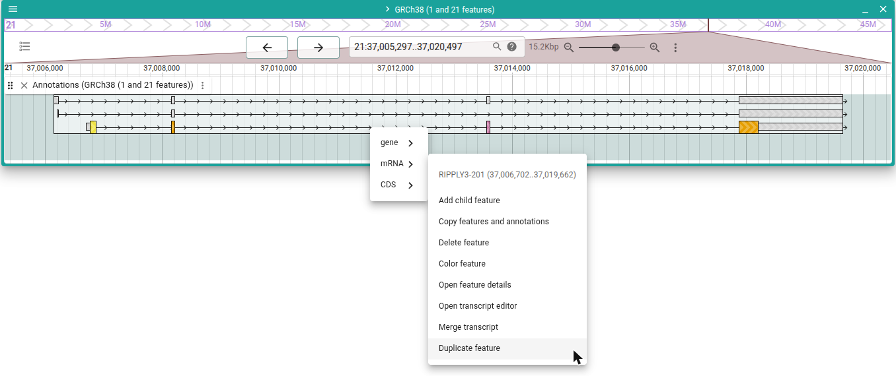
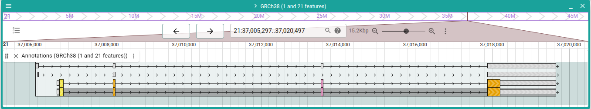
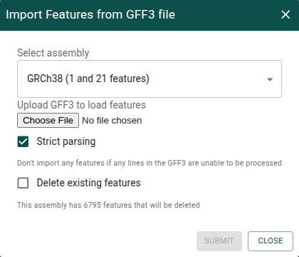
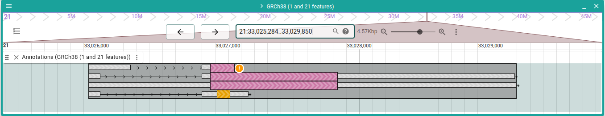

# Beta Version 0.3.12

We are excited to release version `v0.3.12` of Apollo 3. This release moves
Apollo to JBrowse 2 version 4 and brings more flexible GFF3 import, faster
checks, and a few new editing conveniences. Below are some of the changes since
`v0.3.11` that we'd like to highlight.

When updating Apollo 3 to this version, please also update JBrowse 2 to at least
`v4.1.1`, since the Apollo plugin is now built for JBrowse 2 version 4. The
Apollo CLI now also requires Node.js 20 or higher.

<!-- truncate -->

## New features

### Duplicate a transcript

A new "Duplicate feature" item in a transcript's right-click menu makes a copy
of the transcript in the same gene. This is handy as a starting point for an
alternative transcript.

### Non-strict GFF3 parsing

GFF3 import can now be set to skip any lines it can't process instead of
aborting the whole import. To use it, uncheck the new "Strict parsing" option in
the "Add assembly" and "Import features" dialogs, or pass `--no-strict` to
`apollo assembly add-from-gff` or `apollo feature import`.

### Multi-location top-level features in GFF3

Apollo can now import GFF3 files with top-level features that span multiple
locations (several lines sharing the same ID), and exports them back to GFF3 the
same way.

## Improved functionality

### Search selects the matching feature

When you search for an Apollo feature and navigate to it, the feature is now
selected in the Apollo track so it's easy to find.

### Faster checks and more reliable imports

Running checks on features is much faster. In our testing, checking 1,000
features went from about two and a half minutes to about 35 seconds. A problem
that could cause the collaboration server to run out of memory when importing
many features has also been fixed. `apollo feature import` can now also take the
ID of a file that has already been uploaded instead of a local file name.

### Consistent frame order in the six-frame view

On the forward strand, the six-frame view now uses the same frame row order for
CDS features as it does for stop codons and as the reference sequence display.

### Clearer error messages

Messages shown when an operation is canceled have been improved, and these
errors are now handled more consistently.

## Bug fixes

- Fixed a login problem that could cause authentication to fail and the Sequence
  Ontology not to load.

## For more information

For more details on any of the changes mentioned as well as many more changes
that have been made, please reference the associated GitHub issues.

- Update tests to work with JBrowse v4 by @garrettjstevens in
  https://github.com/GMOD/Apollo3/pull/749
- Standardize abort errors, give better descriptions by @garrettjstevens in
  https://github.com/GMOD/Apollo3/pull/755
- Make frame row order consistent in LinearApolloSixFrameDisplay by
  @garrettjstevens in https://github.com/GMOD/Apollo3/pull/754
- Update packages to use ESM by @garrettjstevens in
  https://github.com/GMOD/Apollo3/pull/753
- Enable verbatimModuleSyntax in tsconfig by @garrettjstevens in
  https://github.com/GMOD/Apollo3/pull/759
- Add menu item to duplicate a transcript by @shashankbrgowda in
  https://github.com/GMOD/Apollo3/pull/756
- Select Apollo track feature that is the result of a search by @shashankbrgowda
  in https://github.com/GMOD/Apollo3/pull/760
- Fix out-of-memory error on feature import by @garrettjstevens in
  https://github.com/GMOD/Apollo3/pull/762
- Improve check performance by @garrettjstevens in
  https://github.com/GMOD/Apollo3/pull/763
- Add option for parsing of GFF3 to be not strict by @garrettjstevens in
  https://github.com/GMOD/Apollo3/pull/764
- Support multi-location top-level features in GFF3 by @garrettjstevens in
  https://github.com/GMOD/Apollo3/pull/765
- Fix sequence ontology not loading by @garrettjstevens in
  https://github.com/GMOD/Apollo3/pull/768

**Full Changelog**: https://github.com/GMOD/Apollo3/compare/v0.3.11...v0.3.12
