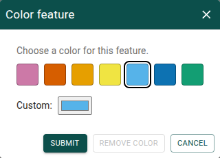
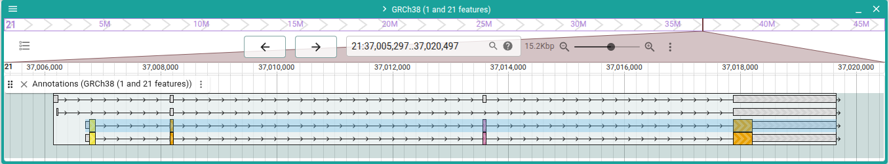
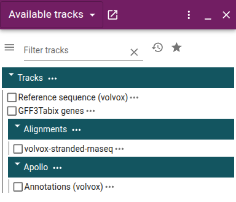
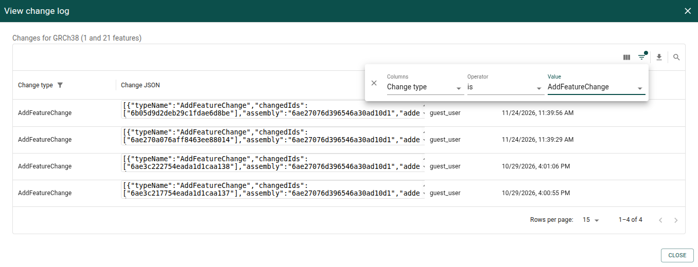
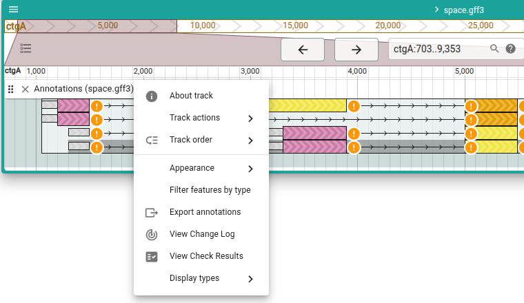
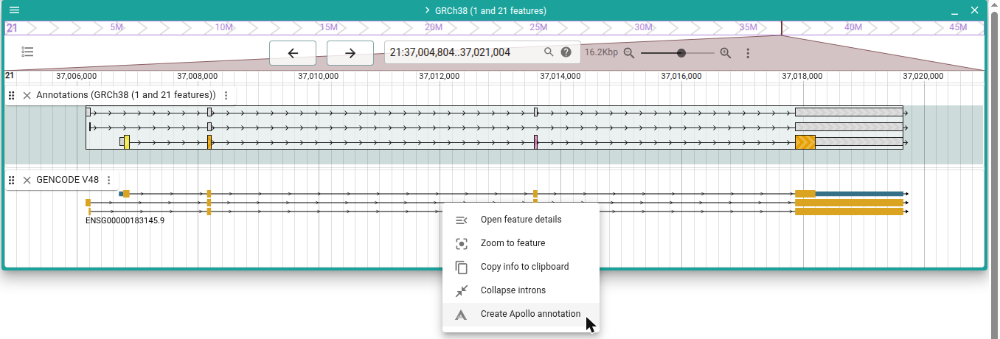
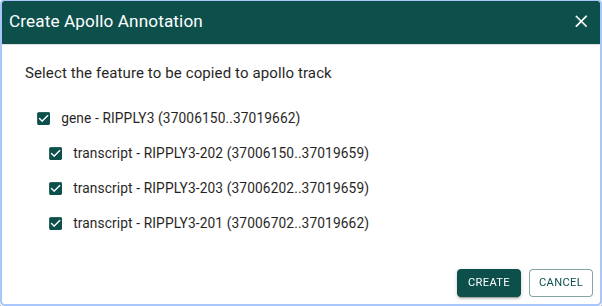
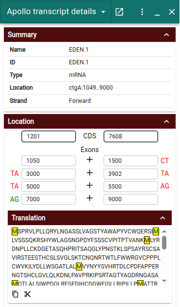
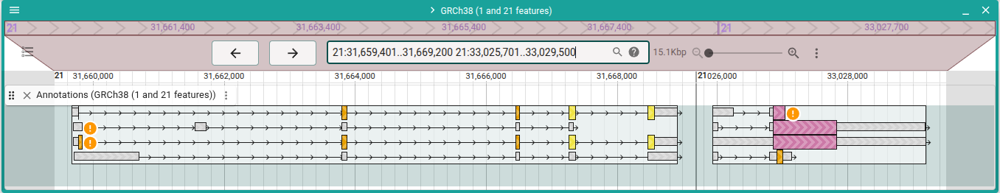

# Version 1.0.0

We are excited to release version `v1.0.0` of Apollo 3! Along with this release,
we invite you to read our paper on Apollo 3, now available as a preprint:

> **[Apollo 3: Multi-Species Genome Curation](https://doi.org/10.64898/2026.06.08.730970)** 
> Stevens GJ, Sutinen K, Beraldi D, et al. _bioRxiv_ (2026). 
> doi:10.64898/2026.06.08.730970

This is the first release after the `v0.3.x` beta series, and it brings new ways
to color and create annotations, a reworked local editing mode, and a faster
change log, along with many fixes. Below are some of the changes since `v0.3.13`
that we'd like to highlight.

When upgrading, please update the Apollo collaboration server, JBrowse plugin,
and Apollo CLI together. The server's `changes` endpoint now returns its results
in a different format to support pagination, so `apollo change get` from an
older CLI version will not work with a `v1.0.0` server.

<!-- truncate -->

## New features

### Color features

You can now give a feature a custom color. This can help you keep track of the
transcript you're focusing on while you click on other features. The color is
stored as an `apollo_color` attribute on the feature, so in a collaborative
installation it is visible to all users and is included in exported GFF3 files.

### Unified local editing

Local (non-collaborative) editing now works the same way in JBrowse Web and
JBrowse Desktop. Annotations and check results are stored in the browser's
IndexedDB, and an Apollo track is created automatically for local assemblies.

### Configure attributes to skip when copying features

A new `skippedAttributesOnCopy` configuration option lists feature attribute
keys that should not be copied when you duplicate a transcript or create an
annotation from a feature in another JBrowse track.

## Improved functionality

### Faster change log

The change log now uses server-side sorting, filtering, and pagination, so it
stays responsive even when there are many changes. It still works with local
editing.

### Track menu reorganization

The "Export annotations", "View change log", and "View check results" menu items
have moved from the top-level Apollo menu to the Apollo track's menu. Apollo
track actions are also available again in the track selector's track menu, where
they had stopped appearing after JBrowse 2 `v4.0`.

### Creating annotations from JBrowse features

When you create an Apollo annotation from a JBrowse gene model, the dialog is
now populated with the whole gene whether you right-clicked the gene or one of
its transcripts, and you can still pick just a transcript from the dialog. The
menu item now uses a grayscale Apollo logo as its icon. JBrowse-internal
attributes are no longer copied into the new feature, and GFF3 reserved
attributes are handled more reliably.

### Clearer transcript location panel

In the transcript details widget, the "Translation" section now appears below
the CDS and exon locations, and the exon locations have their own "Exons" label,
making it clear which coordinates are which.

### Multiple displayed regions

The Apollo annotation track now draws correctly when several regions are
displayed at once instead of drawing outside of its region. Transcripts without
a parent gene are also drawn as transcripts.

## Bug fixes

- Some feature menu items were disabled for non-admin users when they should
  have been available.
- Searching for a transcript by its Apollo ID now highlights the transcript
  instead of its gene.
- If your login token expires, Apollo now prompts you to log in again without
  needing to refresh the page.
- The sequence in the reference sequence track now appears on first load.
- Creating an annotation from an alignments read now works with local editing.
- A child feature added to a feature now has the same strand as its parent.
- Tooltips no longer appear while you click and drag.

## For more information

For more details on any of the changes mentioned as well as many more changes
that have been made, please reference the associated GitHub issues.

- Fix disabled menu items by @garrettjstevens in
  https://github.com/GMOD/Apollo3/pull/769
- Fix highlighting searched feature with apollo id by @shashankbrgowda in
  https://github.com/GMOD/Apollo3/pull/771
- Move change handlers into their own environments by @garrettjstevens in
  https://github.com/GMOD/Apollo3/pull/770
- Reduce circular dependencies by @garrettjstevens in
  https://github.com/GMOD/Apollo3/pull/777
- Rework Linear Apollo Display glyph drawing to handle multiple displayed
  regions by @garrettjstevens in https://github.com/GMOD/Apollo3/pull/725
- Refactor Linear Apollo Display glyph layout methods by @garrettjstevens in
  https://github.com/GMOD/Apollo3/pull/738
- Create unified web and desktop LocalDriver by @garrettjstevens in
  https://github.com/GMOD/Apollo3/pull/778
- Fix creating annotation from read for LocalDriver by @garrettjstevens in
  https://github.com/GMOD/Apollo3/pull/779
- Misc. bugfixes by @garrettjstevens in https://github.com/GMOD/Apollo3/pull/780
- Skip copying certain attributes (configurable) when we create/duplicate a
  feature by @shashankbrgowda in https://github.com/GMOD/Apollo3/pull/781
- Clarify location box of transcript widget by @garrettjstevens in
  https://github.com/GMOD/Apollo3/pull/783
- Restore Apollo actions to track selector track menu by @garrettjstevens in
  https://github.com/GMOD/Apollo3/pull/784
- Better attribute handling when copying JBrowse feature by @garrettjstevens in
  https://github.com/GMOD/Apollo3/pull/785
- Improve creating annotation from JBrowse feature by @garrettjstevens in
  https://github.com/GMOD/Apollo3/pull/787
- Fix sequence sometimes not appearing by @garrettjstevens in
  https://github.com/GMOD/Apollo3/pull/788
- Update demo linked on homepage by @garrettjstevens in
  https://github.com/GMOD/Apollo3/pull/789
- Fix reauthenticate prompt when local token has expired by @garrettjstevens in
  https://github.com/GMOD/Apollo3/pull/790
- Add ability to color features by @garrettjstevens in
  https://github.com/GMOD/Apollo3/pull/792
- Add server-side sort, filter, and pagination to changelog by @garrettjstevens
  in https://github.com/GMOD/Apollo3/pull/794

**Full Changelog**: https://github.com/GMOD/Apollo3/compare/v0.3.13...v1.0.0
