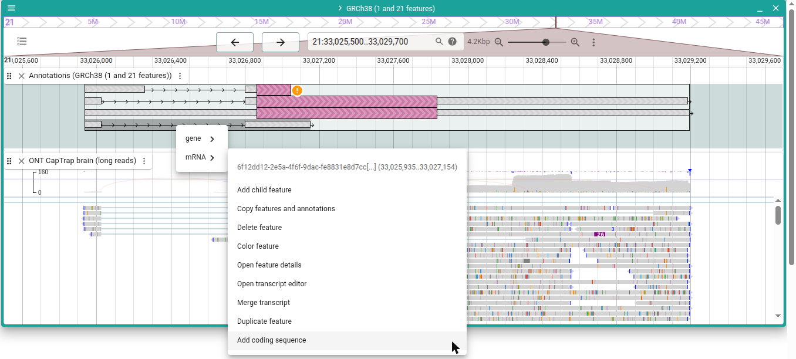
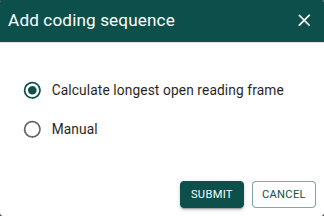
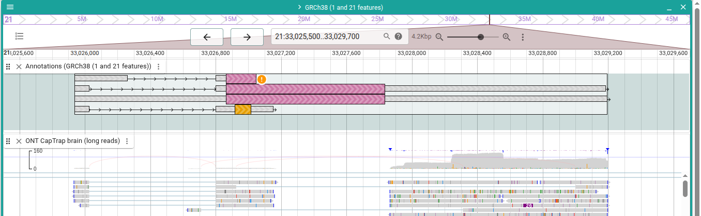
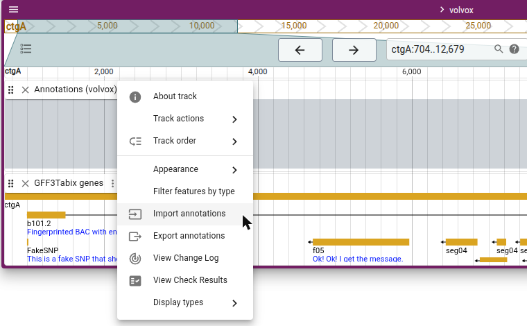
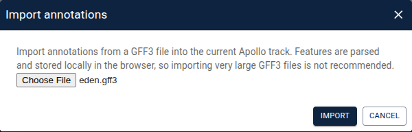
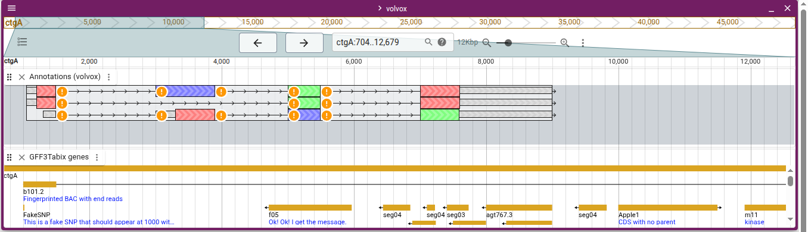
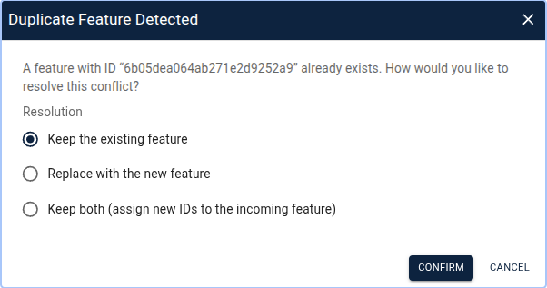
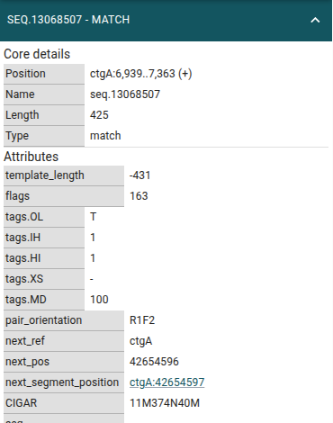
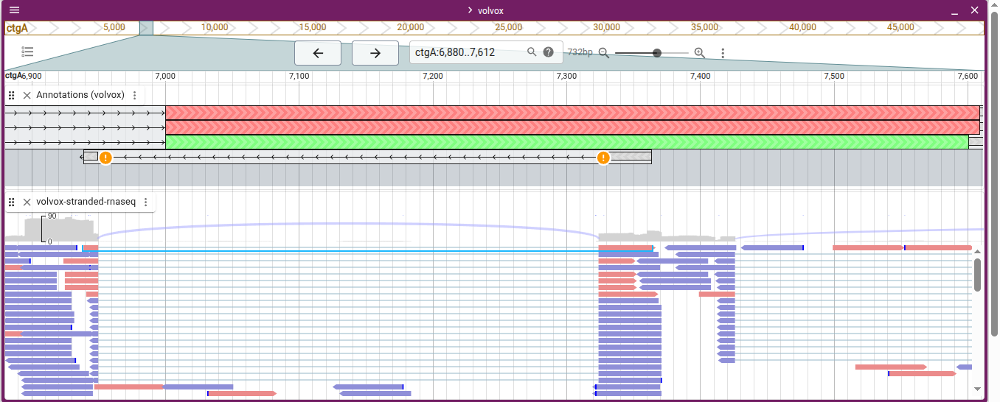

# Version 1.1.0

We are excited to release version `v1.1.0` of Apollo 3, which adds a new user
guide, better tools for local editing, and new ways to build gene models from
RNA-seq evidence. Below are some of the changes since `v1.0.1` that we'd like to
highlight.

This release updates Apollo to JBrowse 2 `v4.3.0`, so we recommend using JBrowse
2 `v4.3.0` or later with it.

<!-- truncate -->

## New features

### User guide and reorganized documentation

The documentation now has a user guide with step-by-step instructions for common
annotation tasks, such as adding a gene, merging transcripts, and modifying exon
coordinates. Some guide pages include links that open a session with example
annotations already loaded. There are also new instructions for using Apollo as
a single user in JBrowse Web and JBrowse Desktop, and the documentation sidebar
has been reorganized to make things easier to find.

### Add coding sequence

Transcripts that don't have a coding sequence, such as those created from an
RNA-seq read, now have an "Add coding sequence" menu item. By default it uses
the longest open reading frame as the CDS, or you can enter the bounds yourself.

### Import features in local editing

When using local (non-collaborative) editing, the Apollo track menu now has an
option to import features from a GFF3 file into the track.

### Share features in a link

In local editing, annotations are stored in your browser, so a shared session
link didn't include them. Features can now be encoded in a URL parameter, and
opening such a link adds them to your local annotations. If a feature was
already loaded, you can choose to keep the new version, the old version, or
both.

### Custom login methods

The collaboration server now has an extension point for adding login methods
beyond the built-in Google and Microsoft options. See the new "Custom login"
page in the developer guide for details.

## Improved functionality

### Transcript strand from RNA-seq reads

When you create a transcript from an RNA-seq read, Apollo now uses the read's
`ts`, `TS`, or `XS` tag, if present, to set the transcript's strand. Previously
it used the read's alignment strand, which isn't necessarily the strand of the
gene.

## Bug fixes

- The standard reference sequence display, the "Get sequence" rubberband dialog,
  and the "Sequence search" dialog work again.
- The "trim" button in the transcript panel now trims the CDS to the last stop
  codon instead of the first one.

## For more information

For more details on any of the changes mentioned as well as many more changes
that have been made, please reference the associated GitHub issues.

- JBrowse 4.3.0 dependency upgrade by @garrettjstevens in
  https://github.com/GMOD/Apollo3/pull/795
- Upgrade to ESLint 10 by @garrettjstevens in
  https://github.com/GMOD/Apollo3/pull/800
- Add user guide, restructure docs by @garrettjstevens in
  https://github.com/GMOD/Apollo3/pull/801
- Add configurable authentication by @garrettjstevens in
  https://github.com/GMOD/Apollo3/pull/758
- Fix various sequence-related features not working by @garrettjstevens in
  https://github.com/GMOD/Apollo3/pull/807
- Add dialog for importing features in local editing by @garrettjstevens in
  https://github.com/GMOD/Apollo3/pull/806
- Add ability to share features in URL param in local editing by
  @garrettjstevens in https://github.com/GMOD/Apollo3/pull/808
- Fix end location detection of transcript "trim" button by @garrettjstevens in
  https://github.com/GMOD/Apollo3/pull/810
- Use alignment read tag for transcript strand by @garrettjstevens in
  https://github.com/GMOD/Apollo3/pull/811
- Add "Add coding sequence" menu item to transcripts by @garrettjstevens in
  https://github.com/GMOD/Apollo3/pull/812
- Add links with shared features to the user guide by @garrettjstevens in
  https://github.com/GMOD/Apollo3/pull/809

**Full Changelog**: https://github.com/GMOD/Apollo3/compare/v1.0.1...v1.1.0
