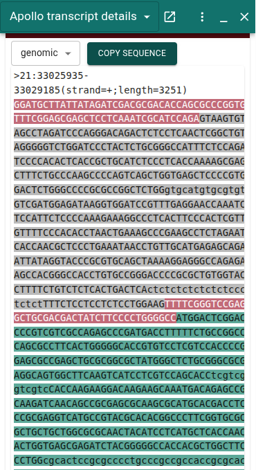

# Version 1.1.3

We are excited to release version `v1.1.3` of Apollo 3. This patch release
includes a fix to the sequence viewer since `v1.1.2`.

<!-- truncate -->

## Bug fixes

### Missing nucleotide in the sequence panel

In the transcript details sequence panel, when a new segment (such as an exon)
started at the beginning of a line, the first nucleotide of the following line
was left out. This has been fixed, thanks to a report from the HAVANA team.

The generic feature details widget also now uses the same, more full-featured
sequence panel as the transcript details.

## For more information

For more details on any of the changes mentioned as well as many more changes
that have been made, please reference the associated GitHub issues.

- Fix missing nucleotide in sequence viewer in some cases by @garrettjstevens in
  https://github.com/GMOD/Apollo3/pull/836

**Full Changelog**: https://github.com/GMOD/Apollo3/compare/v1.1.2...v1.1.3
