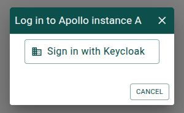
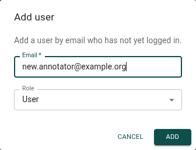

# Version 1.2.0

We are excited to release version `v1.2.0` of Apollo 3, which adds support for
logging in with any OpenID Connect provider, new options for managing users, and
several CLI improvements. Below are some of the changes since `v1.1.3` that we'd
like to highlight.

When upgrading, please update the Apollo Collaboration Server and the Apollo
JBrowse plugin together. Starting with this release, the plugin checks that it
is the same version as the server and shows an error if they don't match, since
mismatched versions can cause Apollo to not work correctly. The plugin also now
requires JBrowse 2 version 4 (`4.x.x`) and will not load in other major
versions. Also, if you serve JBrowse from a different domain or port than
Apollo, add JBrowse's origin to the new `ALLOWED_REDIRECT_ORIGINS` configuration
option so that logins can redirect back to it.

<!-- truncate -->

## New features

### Log in with any OpenID Connect provider

Apollo can now use any login provider that supports
[OpenID Connect](https://openid.net/developers/how-connect-works/) (OIDC), such
as Keycloak, Okta, Auth0, GitLab, or your institution's single sign-on. One or
more providers can be set up with only configuration options, no plugin needed.
Google and Microsoft logins work the same as before, and existing setups don't
need any changes. Microsoft logins can also now be limited to a single
organization with the `MICROSOFT_TENANT` option. See the "Login management" page
in the documentation for details.



### Log in from the CLI on a remote server

`apollo login` now prints a URL and a short code for browser-based logins. You
can open the URL in a browser on any computer, check that the code matches, and
sign in, which means the CLI can log in even when running on a remote server
(e.g. over SSH). Use `--no-browser` to only print the URL. This replaces the
previous `--port` option.

```console
$ apollo login --no-browser
To log in, open this URL in a browser on any computer:

  https://apollo.example.org/apollo/auth/device?user_code=CQTQ-QSGZ

and check that it shows this code:

  CQTQ-QSGZ

Waiting for login in the browser...
```

### More user setup options

Admins have new ways to control who can use Apollo:

- `INITIAL_ADMIN_EMAIL` sets the email of the first admin, instead of making the
  first user who logs in an admin. Nobody else can log in until this user has
  logged in for the first time.
- Users can be added by email, with a role, before they log in for the first
  time, either from the user management UI or with the new `apollo user add`
  command.
- `ONLY_ALLOW_APPROVED_USERS` limits logins to users that an admin has added (or
  who have logged in before).



```console
$ apollo user add --email jane.doe@example.com --role readOnly
{
  "_id": "6b05ef129a3ea838d1f5d0e6",
  "email": "jane.doe@example.com",
  "role": "readOnly",
  "createdAt": "2026-11-24T20:09:54.074Z",
  "updatedAt": "2026-11-24T20:09:54.074Z",
  "__v": 0
}
```

## Improved functionality

### Account name in `apollo status`

`apollo status` now shows the username and email of the logged-in account, and
notes when the saved token has expired.

```console
$ apollo status
default: Logged in as root
```

### More consistent server URL handling in the CLI

The CLI now handles the configured server address consistently whether or not it
has a trailing slash, so commands work for servers hosted under a path like
`/apollo`.

### Improved server logging

The collaboration server's log messages are more consistent, and each one now
includes a correlation ID so it can be traced back to the request that caused
it.

### Smaller plugin bundle

The Apollo JBrowse plugin is about 15% smaller, which helps it load faster.

### Updated server libraries

The collaboration server has been updated to NestJS v11 and Mongoose v9, which
helps keep it compatible with future MongoDB versions.

## Bug fixes

### Duplicate menus and messages after an expired login

If your login had expired when JBrowse started, Apollo could add a second
"Admin" menu and process incoming updates from the server twice. This has been
fixed.

### Documentation fixes

Several broken links and setup instructions in the documentation have been
fixed.

## For more information

For more details on any of the changes mentioned as well as many more changes
that have been made, please reference the associated GitHub issues.

- Standardize and clean up server logging by @garrettjstevens in
  https://github.com/GMOD/Apollo3/pull/841
- Upgrade to TypeScript 6 by @garrettjstevens in
  https://github.com/GMOD/Apollo3/pull/843
- Track test coverage and improve testing by @garrettjstevens in
  https://github.com/GMOD/Apollo3/pull/842
- Migrate from Rollup to Rolldown by @garrettjstevens in
  https://github.com/GMOD/Apollo3/pull/824
- Update NestJS to v11 and Mongoose to v9 by @garrettjstevens in
  https://github.com/GMOD/Apollo3/pull/832
- Clean up dependencies and peer dependency warnings by @garrettjstevens in
  https://github.com/GMOD/Apollo3/pull/847
- Split internet account initialize into run-once and retry parts by @cmdcolin
  in https://github.com/GMOD/Apollo3/pull/828
- Bundle size improvements by @garrettjstevens in
  https://github.com/GMOD/Apollo3/pull/850
- Fix docs links and setup instructions by @chefren in
  https://github.com/GMOD/Apollo3/pull/837
- Improve assert messages in CLI tests by @garrettjstevens in
  https://github.com/GMOD/Apollo3/pull/853
- Log in with any OIDC provider by @garrettjstevens in
  https://github.com/GMOD/Apollo3/pull/852
- Add more user setup options by @garrettjstevens in
  https://github.com/GMOD/Apollo3/pull/840
- Improve Cypress test flakiness by @garrettjstevens in
  https://github.com/GMOD/Apollo3/pull/856
- Ensure server, plugin, and JBrowse versions match by @garrettjstevens in
  https://github.com/GMOD/Apollo3/pull/855
- Include name of logged-in account in `apollo status` by @garrettjstevens in
  https://github.com/GMOD/Apollo3/pull/859
- Normalize server URL in CLI by @garrettjstevens in
  https://github.com/GMOD/Apollo3/pull/860

### New Contributors

- @cmdcolin made their first contribution in
  https://github.com/GMOD/Apollo3/pull/828
- @chefren made their first contribution in
  https://github.com/GMOD/Apollo3/pull/837

**Full Changelog**: https://github.com/GMOD/Apollo3/compare/v1.1.3...v1.2.0
