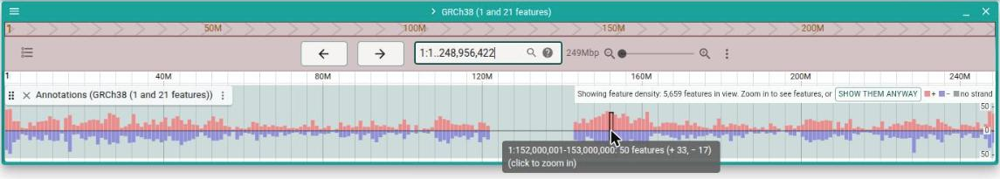
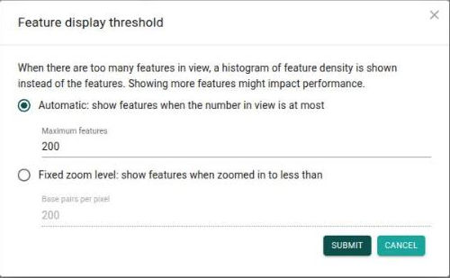
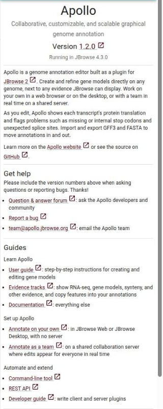

# Version 1.3.0

We are excited to release version `v1.3.0` of Apollo 3, which shows a feature
density histogram when zoomed out, adds a help page inside the app, documents
the collaboration server's REST API, and makes drawing and editing faster and
more accurate. Below are some of the changes since `v1.2.0` that we'd like to
highlight.

When upgrading, note that while the Apollo Collaboration Server and the Apollo
CLI already required Node.js 22.19.0 or later to work properly, that dependency
is now enforced by the `package.json`'s "engines" policy. The Docker images also
now use Node.js 26. As before, please update the Apollo Collaboration Server and
the Apollo JBrowse plugin together.

<!-- truncate -->

## New features

### Feature density histogram when zoomed out

Previously, zooming out past a certain threshold on the Apollo track replaced
the display with a message asking you to zoom in. Now Apollo checks how many
features are in view. If there are more than 200, it shows a histogram of
feature density, split by strand, instead of the features. Hovering over a bar
shows the region and how many features it has on each strand, and clicking a bar
zooms in to that region. Because the switch is based on the number of features
instead of the zoom level, sparse annotations and long features can now be seen
when zoomed far out. You can also click "Show them anyway" to draw the features
instead of the histogram regardless of the zoom level.

The new "Feature display threshold" dialog (in the track menu under
"Appearance") replaces "Change zoom threshold." In it you can change the maximum
number of features or switch back to the old zoom-level behavior.

### In-app help

There is a new "Help" item in the "Apollo" menu. It opens a panel with the
Apollo and JBrowse versions you are using, where to ask questions or report
bugs, links to the guides and documentation, and how to cite Apollo.

### REST API documentation

The collaboration server's REST API is now documented on the Apollo website,
with a page for every endpoint generated from the server code. See the "REST
API" page in the documentation.

### Get checks with `apollo feature get`

`apollo feature get` has a new `--include-checks` option. With it, the output is
an array of the features and an array of the check results for those features.

## Improved functionality

### Faster drawing

The Apollo track redraws much less often and draws each frame faster. In our
testing with thousands of features in view, the time the browser was busy after
each zoom went from 5-8 seconds to under 1 second. Collapsing rows in the table
editor is also faster.

### Six-frame display

- The six-frame display now works correctly when viewing more than one region.
- Genes in the six-frame display are now drawn with the same background colors
  as in the main Apollo display, so pseudogenes, ncRNA genes, and custom
  `geneBackgroundColor` settings are shown.

### Editing fixes

- Dragging the end of a CDS past its exon now extends the exon too.
- Mouse positions were sometimes off by one base, and dragging a feature edge
  now snaps to the nearest base.
- Copying a feature to a position no longer places it one base too far.
- The transcript sequence panel now updates when an exon is changed while it is
  open.

### Other fixes

- In a view with multiple regions, regions after an empty region are now drawn.
- Check results returned by the server are now always up to date and include
  every check for the features returned.
- If exporting GFF3 fails, the error message now stays visible so you can try
  again.
- Collaborators' locations are shown correctly when a session has views other
  than linear genome views.
- A server crash when an uploaded compressed file could not be unzipped has been
  fixed.
- A few places in the UI that showed 0-based positions instead of 1-based
  positions have been fixed.

## For more information

For more details on any of the changes mentioned as well as many more changes
that have been made, please reference the associated GitHub issues.

- Fix off-by-one error when copying features by @YashAnand69 in
  https://github.com/GMOD/Apollo3/pull/861
- Add option to get checks in `feature get` output by @YashAnand69 in
  https://github.com/GMOD/Apollo3/pull/864
- Ensure checks are current and cover all features by @garrettjstevens in
  https://github.com/GMOD/Apollo3/pull/866
- Fix second region not rendering if first is empty by @YashAnand69 in
  https://github.com/GMOD/Apollo3/pull/869
- Fix exon bounds when extending a CDS graphically by @YashAnand69 in
  https://github.com/GMOD/Apollo3/pull/867
- Add Cypress test for local-editing mode by @garrettjstevens in
  https://github.com/GMOD/Apollo3/pull/868
- Fix six frame display when displaying multiple regions by @garrettjstevens in
  https://github.com/GMOD/Apollo3/pull/871
- Fix table editor row collapsing feeling slow by @garrettjstevens in
  https://github.com/GMOD/Apollo3/pull/872
- Add feature density histogram when zoomed out by @garrettjstevens in
  https://github.com/GMOD/Apollo3/pull/873
- Fix error message being hidden if GFF3 export fails by @YashAnand69 in
  https://github.com/GMOD/Apollo3/pull/875
- Show gene background colors in six-frame display by @YashAnand69 in
  https://github.com/GMOD/Apollo3/pull/870
- Improve layout and drawing performance by @garrettjstevens in
  https://github.com/GMOD/Apollo3/pull/876
- Move check bootstrapping to onApplicationBootstrap by @garrettjstevens in
  https://github.com/GMOD/Apollo3/pull/881
- Harden GitHub Actions workflows by @garrettjstevens in
  https://github.com/GMOD/Apollo3/pull/884
- Fix off-by-one error in mouse position by @garrettjstevens in
  https://github.com/GMOD/Apollo3/pull/883
- Add Cypress test for hovering a feature in the Apollo display by
  @garrettjstevens in https://github.com/GMOD/Apollo3/pull/885
- Remove sequence worker listeners after timeouts by @YashAnand69 in
  https://github.com/GMOD/Apollo3/pull/878
- Standardize main-thread requests and cleanup by @garrettjstevens in
  https://github.com/GMOD/Apollo3/pull/886
- Bump devcontainers/javascript-node from `1bc82e3` to `72c2f2a` in
  /.devcontainer in the docker group across 1 directory by @dependabot[bot] in
  https://github.com/GMOD/Apollo3/pull/890
- Bump docker/login-action from 4.7.0 to 4.8.0 in the github-actions group by
  @dependabot[bot] in https://github.com/GMOD/Apollo3/pull/891
- Fix server crash on unzip error by @garrettjstevens in
  https://github.com/GMOD/Apollo3/pull/888
- Upgrade to Node 26 by @garrettjstevens in
  https://github.com/GMOD/Apollo3/pull/887
- Implement some Docker best practices by @garrettjstevens in
  https://github.com/GMOD/Apollo3/pull/892
- Document the collaboration server's REST API on the website by
  @garrettjstevens in https://github.com/GMOD/Apollo3/pull/889
- Keep collaborator locations with mixed view types by @YashAnand69 in
  https://github.com/GMOD/Apollo3/pull/880
- Fix transcript sequences showing outdated sequence by @YashAnand69 in
  https://github.com/GMOD/Apollo3/pull/893
- Update the local docker-compose walkthrough and Ubuntu installation guide by
  @garrettjstevens in https://github.com/GMOD/Apollo3/pull/895
- Add "Help" menu item to "Apollo" top-level menu by @garrettjstevens in
  https://github.com/GMOD/Apollo3/pull/901
- Generate GitHub releases and emails from release blog posts and add past
  version blog posts by @garrettjstevens in
  https://github.com/GMOD/Apollo3/pull/902
- Fix UI showing 0-based coordinates by @garrettjstevens in
  https://github.com/GMOD/Apollo3/pull/903

### New Contributors

- @YashAnand69 made their first contribution in
  https://github.com/GMOD/Apollo3/pull/861
- @dependabot[bot] made their first contribution in
  https://github.com/GMOD/Apollo3/pull/890

**Full Changelog**: https://github.com/GMOD/Apollo3/compare/v1.2.0...v1.3.0
