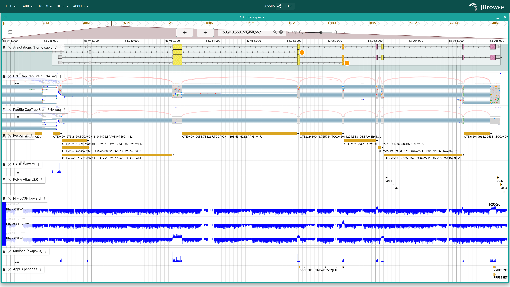

# Single genome with deep evidence: step by step

These steps build the
[single genome with deep evidence demo](/demos/paper_2026#single-genome-with-deep-evidence)
view by hand, starting from an empty session. The finished view shows the human
gene _LRRC42_ in an Apollo annotation track, with long-read RNA-seq, splice
junction, CAGE, polyA, conservation, Ribo-seq, and peptide evidence below it.

## 1. Open the region

1. Go to
   [apollo.jbrowse.org/paper_2026/](https://apollo.jbrowse.org/paper_2026/). A
   new session opens with an empty linear genome view. If it doesn't, select
   **Add → Linear genome view**.
2. In the view's **Assembly** box, choose **Homo sapiens**.
3. In the location box next to it, enter `1:53943568-53968567` and click
   **Open**.

Use a wide browser window if you can. The view fits the region to the window
width when you open it.

## 2. Add the evidence tracks

Click **Open track selector** and turn on these tracks in this order. Tracks
appear in the view in the order you turn them on.

1. Apollo → **Annotations (Homo sapiens)**
2. Tracks → **ONT CapTrap Brain RNA-seq**
3. Tracks → **PacBio CapTrap Brain RNA-seq**
4. Tracks → **Recount3**
5. Tracks → **CAGE forward**
6. Tracks → **PolyA Atlas v2.0**
7. Tracks → **PhyloCSF forward**
8. Tracks → **Riboseq (gwipsvis)**
9. Tracks → **Appris peptides**

Close the track selector with the **×** in its top right corner. If the view
looks zoomed out afterwards, enter the location from step 1 again.

To pack the long reads more tightly, as in the screenshot, open the **⋮** menu
on each CapTrap track and select **Pileup settings → Set feature height… →
Compact**.

## 3. Add the starting annotation

The demo link loads the _LRRC42_ gene, with four of its transcripts, into the
Annotations track. If you've opened the demo link in this browser before, the
gene is already saved in your browser and you can skip this step. Otherwise,
copy it from the Ensembl gene track:

1. Open the track selector and turn on Genes → **Ensembl genes**. It appears at
   the bottom of the view.
2. Scroll down to the Ensembl genes track. The _LRRC42_ transcripts span the
   whole view. If you only see the neighboring gene, scroll inside the track to
   find them.
3. Right-click one of the _LRRC42_ transcripts and select **Create Apollo
   annotation**.
4. To match the demo, uncheck **LRRC42-203** and **LRRC42-205**, leaving the
   gene and LRRC42-206, -202, -201, and -204 checked. Click **Create**.
5. Close the **Ensembl genes** track with the **×** next to its name.

The gene appears in **Annotations (Homo sapiens)** with four transcripts. The
orange **!** markers show problems that Apollo's checks found in two of them.

Apollo uses local editing on this site, so your annotations are stored only in
your browser and nobody else sees them.
