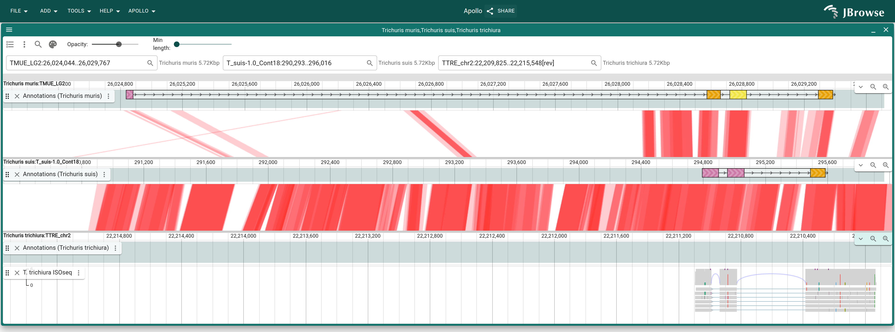
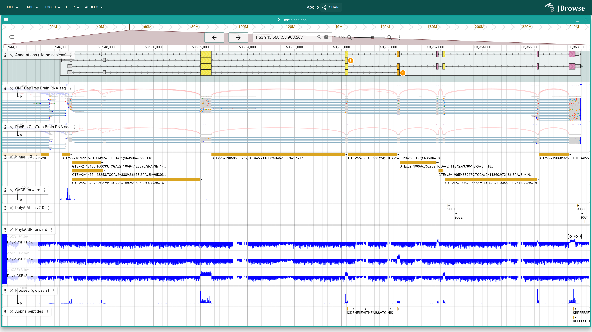
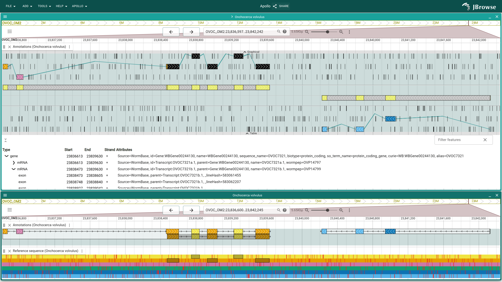

import { paperDemoUrls } from '@site/src/demoUrls'

# 2026 paper

The demos linked here are based on the use cases presented in our 2026
in-submission paper on Apollo 3. These demos are set up for Apollo to use local
editing. This means that you are free to edit the annotations however you want,
and it won't affect anyone else (i.e. the annotations are not shared).

## Multi-genome curation project

<a href={paperDemoUrls.multiGenomeCuration}
className="button button--primary button--lg" target="_blank">Try it out</a>

To build this view yourself from an empty session, follow the
[step-by-step instructions](/demos/paper_2026/multi_genome_curation).

---

## Single genome with deep evidence

<a href={paperDemoUrls.deepEvidence}
className="button button--primary button--lg" target="_blank">Try it out</a>

To build this view yourself from an empty session, follow the
[step-by-step instructions](/demos/paper_2026/deep_evidence).

---

## Single local genome

<a href={paperDemoUrls.singleLocalGenome}
className="button button--primary button--lg" target="_blank">Try it out</a>

To build this view yourself from an empty session, follow the
[step-by-step instructions](/demos/paper_2026/six_frame).
