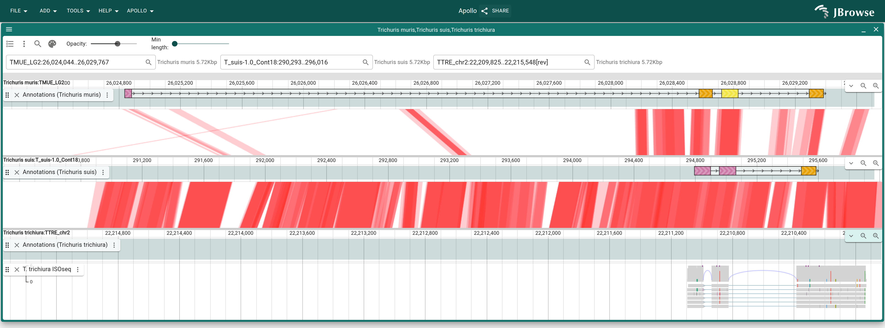

# Multi-genome curation project: step by step

These steps build the
[multi-genome curation demo](/demos/paper_2026#multi-genome-curation-project)
view by hand, starting from an empty session. The finished view is a three-way
synteny view of _Trichuris muris_, _Trichuris suis_, and _Trichuris trichiura_
with Apollo annotation tracks and _T. trichiura_ Iso-Seq evidence.

## 1. Open Apollo

Go to [apollo.jbrowse.org/paper_2026/](https://apollo.jbrowse.org/paper_2026/).
Use a wide browser window if you can. Each row sets its zoom level to fit the
window when you go to a location, so a narrow window shows less detail.

If a linear genome view opens with an assembly selector, close it with the **×**
in the top right corner of the view.

## 2. Create a three-row synteny view

1. Select **Add → Linear synteny view**.
2. Set **Row 1** to **Trichuris muris** and **Row 2** to **Trichuris suis**.
3. Click **Add row** and set **Row 3** to **Trichuris trichiura**.
4. Click the arrow between rows 1 and 2. Under "Synteny dataset to display
   between row 1 and 2", keep **Existing track** and choose **muris (t) vs suis
   (q) TBLASTX**.
5. Click the arrow between rows 2 and 3 and choose **suis (t) vs trichiura (q)
   TBLASTX**.
6. Click **Launch**.

## 3. Go to the region of interest

Each row has its own location box above the view. Replace the text in each box
with the location below and press <kbd>Enter</kbd>:

| Row                | Location                          |
| ------------------ | --------------------------------- |
| _T. muris_ (1)     | `TMUE_LG2:26024059-26029782`      |
| _T. suis_ (2)      | `T_suis-1.0_Cont18:294592-296060` |
| _T. trichiura_ (3) | `TTRE_chr2:22209801-22211269`     |

The gene runs in the opposite direction in _T. trichiura_, so flip that row:
click the **⌄** menu at the right end of row 3 and select **Horizontally flip**.
The row 3 location now ends in `[rev]`.

## 4. Add tracks

Click **Open track selector** in the middle of each row (or use **Open track
selector** in that row's **⌄** menu) and turn on these tracks:

| Row                | Tracks                                                                           |
| ------------------ | -------------------------------------------------------------------------------- |
| _T. muris_ (1)     | Apollo → **Annotations (Trichuris muris)**                                       |
| _T. suis_ (2)      | Apollo → **Annotations (Trichuris suis)**                                        |
| _T. trichiura_ (3) | Apollo → **Annotations (Trichuris trichiura)**, Tracks → **T. trichiura ISOseq** |

Close the track selector with the **×** in its top right corner. The track
selector makes the view narrower while it's open, so if the rows look zoomed out
afterwards, enter the locations from step 3 again.

## 5. Add the starting annotations

The demo link loads a gene model into the _T. muris_ and _T. suis_ Annotations
tracks. If you've opened the demo link in this browser before, those models are
already saved in your browser and you can skip this step. Otherwise, copy them
from the WormBase gene tracks:

1. Open the track selector for row 1 and turn on Genes → **WormBase genes**.
2. Right-click the gene **WBGene00294573** and select **Create Apollo
   annotation**.
3. Leave the gene and its mRNA checked and click **Create**. The gene appears in
   **Annotations (Trichuris muris)**.
4. Repeat for row 2 with the _T. suis_ gene **D918_05905**.
5. Close the **WormBase genes** tracks with the **×** next to their names if you
   want the view to match the screenshot.

The _T. trichiura_ Annotations track starts out empty. Use the Iso-Seq reads
below it as evidence to build a gene model there.

Apollo uses local editing on this site, so your annotations are stored only in
your browser and nobody else sees them.
