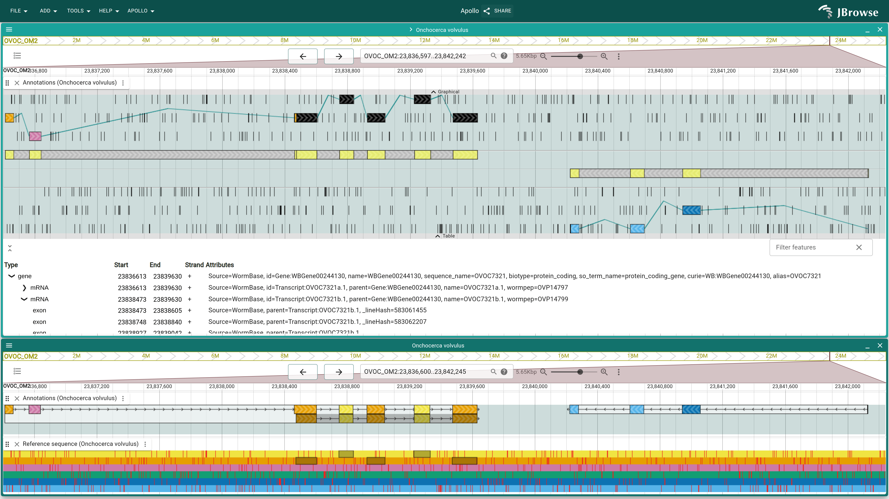

# Single local genome: step by step

These steps build the
[single local genome demo](/demos/paper_2026#single-local-genome) view by hand,
starting from an empty session. The finished view shows the same _Onchocerca
volvulus_ region twice. The top view has the Apollo annotations in a six-frame
display with a feature table. The bottom view has the standard annotation
display with a six-frame reference sequence track.

## 1. Open the region

1. Go to
   [apollo.jbrowse.org/paper_2026/](https://apollo.jbrowse.org/paper_2026/). A
   new session opens with an empty linear genome view. If it doesn't, select
   **Add → Linear genome view**.
2. In the view's **Assembly** box, choose **Onchocerca volvulus**.
3. In the location box next to it, enter `OVOC_OM2:23836597-23842242` and click
   **Open**.

## 2. Add the starting annotations

The demo link loads the gene _WBGene00244130_, with two transcripts, into the
Annotations track. If you've opened the demo link in this browser before, the
gene is already saved in your browser and you can skip this step. Otherwise,
copy it from the WormBase gene track:

1. Click **Open track selector** and turn on Apollo → **Annotations (Onchocerca
   volvulus)** and Genes → **WormBase genes**.
2. Right-click the gene **WBGene00244130** in the WormBase genes track and
   select **Create Apollo annotation**.
3. Leave the gene and both of its mRNAs checked and click **Create**.
4. The screenshot also shows the neighboring gene on the reverse strand. To
   include it, repeat steps 2 and 3 for **WBGene00244131**.
5. Close the **WormBase genes** track with the **×** next to its name.

If you skipped this step, still turn on **Annotations (Onchocerca volvulus)** in
the track selector.

## 3. Set up the six-frame view

1. Open the **⋮** menu next to the **Annotations (Onchocerca volvulus)** track
   name and select **Display types → LinearApolloSixFrameDisplay**. The
   annotations are now drawn in the reading frame of each coding segment.
2. Open the same **⋮** menu again and select **Appearance → Show both graphical
   and table display**. A table of the features appears under the graphical
   display.

Start and stop codons are only drawn when you're zoomed in far enough. If you
don't see the black stop codon marks, click the zoom-in button (**+** magnifying
glass) once or twice.

## 4. Add the second view

1. Select **Add → Linear genome view**. A new view opens under the first one.
2. Choose **Onchocerca volvulus** as the assembly, enter
   `OVOC_OM2:23836597-23842242`, and click **Open**.
3. Click **Open track selector** and turn on Apollo → **Annotations (Onchocerca
   volvulus)** and Tracks → **Reference sequence (Onchocerca volvulus)**.
4. Close the track selector with the **×** in its top right corner.

The reference sequence track shows the six reading frames with stop codons
marked in red. If it shows "Zoom in to see sequence", zoom in on this view until
the frames appear.

Apollo uses local editing on this site, so your annotations are stored only in
your browser and nobody else sees them.
